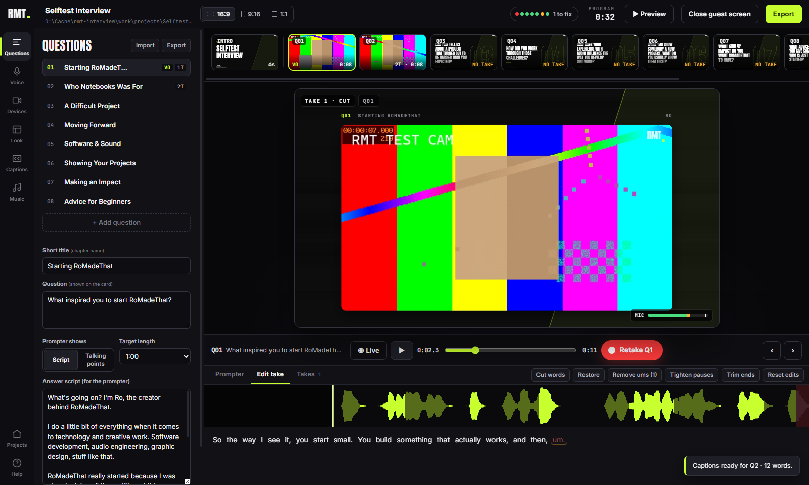

# RoMadeThat Interview Studio

A desktop interview studio for Windows and macOS. Record yourself asking each question once, play it to your guest, record every answer as its own take, cut the "um"s by deleting words, and export a finished interview with captions, chapters and a clip for each question.



## What it does

**Before the interview**
- **Questions + scripts.** Write each question with a full answer script for the teleprompter, or with talking points if the guest answers freely. Import a list from `.json` or `.txt` (one question per line, or `Q:` / `A:` blocks).
- **Question voice.** Record yourself asking each question (batch mode: <kbd>Space</kbd> record / next, <kbd>R</kbd> redo). Silence is trimmed off automatically. You can also import an audio file. Your guest hears it before each answer, and it goes into the final edit, cleaned and level-matched.
- **Ready check.** Camera resolution, lighting, mic level, clipping, room noise and free disk space, all checked live before you roll.

**During the interview**
- **Card → your voice → countdown → answer.** Each question shows its card, plays your recorded voice, counts down, then records the answer.
- **Takes, not one long recording.** Every answer is saved as its own take. <kbd>R</kbd> retakes a question without starting the interview over. Star the keepers and choose which take goes in the edit.
- **Guest screen.** A second window, full screen on another monitor, for the person in the chair. It shows the question, countdown, prompter and a time bar, and never shows the controls. You can mirror it for teleprompter glass.
- **Prompter that follows the speaker.** It only scrolls while the guest is talking, so it doesn't run ahead during a pause.
- **Target length per question.** The timer warns near the target and shows "wrap it up" when the answer runs over.

**After the interview**
- **Local captions.** Whisper runs on your own computer, with no Python, no cloud and no upload. You get word-level timing.
- **Edit by text.** Click a word to jump to it. Select words and press <kbd>Delete</kbd> to cut them. **Remove ums** cuts every filler word at once. **Tighten pauses** shortens long gaps. Double-click a word to fix its spelling in the captions.
- **Look.** Four styles (Street Editorial, Cinematic Gold, Clean Studio, Neon Gradient), any accent colour, a full-frame or framed layout, the guest's name as a lower-third, and your logo in the corner. The cards are drawn when you export, so you can change the style after recording.
- **Export.** 16:9, 9:16 and 1:1 MP4s, with captions burned in (Bold pop / Clean box / Minimal) or left off. Every voice is level-matched to -16 LUFS. You also get an `.srt`, YouTube chapters, a full transcript, an optional music bed that dips under the answers, and a separate clip for every question.

Everything for an interview lives in one project folder (`Documents/RoMadeThat Interviews/<title>`): `project.json`, `takes/`, `voice/`, `assets/`, `exports/`.

## Download

Get the latest installers from **Releases**, or from the newest run on the **Actions** tab (under *Artifacts*):

| Platform | File |
|---|---|
| Windows 10/11 (x64) | `RoMadeThat-Interview-Studio-<ver>-win-x64.exe` (installer) or `…-portable.exe` |
| macOS (Apple Silicon M1–M4) | `RoMadeThat-Interview-Studio-<ver>-mac-arm64.dmg` |

The Mac build has an ad-hoc signature, not an Apple notarisation. The first time you open it, right-click the app and choose **Open**, then **Open** again. If macOS says the app is damaged, run this once:

```bash
xattr -dr com.apple.quarantine "/Applications/RoMadeThat Interview Studio.app"
```

macOS asks for camera and microphone access on first launch. Allow both.

## Build it yourself

You need Node.js 20 or newer.

```bash
npm install
npm start
```

Build installers. Each OS builds its own:

```bash
npm run dist:win   # on Windows → release/*.exe
npm run dist:mac   # on a Mac   → release/*.dmg + *.zip
```

You don't need a Mac to get the Mac build. Push to `main`, or push a tag like `v2.0.1`, and GitHub Actions (`.github/workflows/build.yml`) builds both platforms. Tags also attach the installers to a Release.

### Self test

`scripts/selftest.mjs` runs the real app against a fake camera and mic. It records a question voice and three takes, transcribes them, cuts the fillers and exports 16:9 + 9:16, then saves screenshots of each step:

```bash
node scripts/selftest.mjs <workDir> <fake-cam.y4m> <fake-audio.wav>
```

It uses its own profile and project folder, so it never touches your real ones.

## How it's built

- Electron 45. The UI is plain HTML/CSS/JS ES modules with no build step (`src/renderer`).
- The **Main process** (`src/main`) handles file IO, streams recordings straight to disk, remuxes them and analyses the audio (waveform peaks, speech start/end, noise floor).
- **ffmpeg** comes from `ffmpeg-static`. Export renders every segment through the same pipeline (cards as PNG + your voice, answers as trimmed and cut ranges with the layout, lower-third, logo and ASS captions), then joins them. Loudness is matched with two-pass `loudnorm`.
- **Captions** use `@huggingface/transformers` (Whisper, ONNX on CPU) in an Electron utility process. The model downloads once into the app's data folder.
- `src/renderer/js/draw.js` draws every card, layout and overlay. The monitor preview and the export PNGs both use it, so the preview matches the export.

## Keyboard

| Key | Does |
|---|---|
| <kbd>Space</kbd> | Ask + record the selected question · skip the card · finish the answer |
| <kbd>R</kbd> | Retake (keeps the take, asks again) |
| <kbd>Esc</kbd> | Stop |
| <kbd>←</kbd> <kbd>→</kbd> | Previous / next question |
| <kbd>P</kbd> | Play the question voice |
| <kbd>G</kbd> | Framing guides |
| <kbd>Del</kbd> | Cut the selected words |

## Credits

Fonts are bundled under the SIL Open Font License (`src/renderer/fonts/*-OFL.txt`): Anton, Inter, JetBrains Mono and Playfair Display. Speech recognition uses OpenAI Whisper weights via Xenova/onnx-community conversions.

© RoMadeThat. All rights reserved. The source is public so the app can be built on any platform; ask before reusing it.
